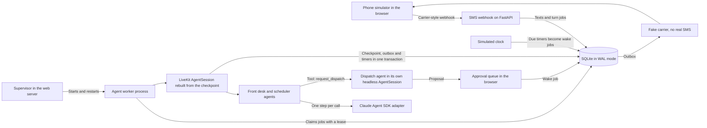

# Durable Text Agents

A prototype SMS channel and durable session layer for LiveKit Agents: every text is one transactional turn that survives worker crashes, hours-long waits, agent handoffs and delegation.


Full video: https://github.com/ArchiusVuong-sudo/durable-text-agents/releases/download/v0.1/demo.mp4

## What it does

- A phone simulator texts a fictional appliance repair desk through a carrier-style webhook. Replies come back as plain SMS with their segment count and encoding (GSM-7 or UCS-2).
- Texts sent in a burst become one turn and one reply. A text that lands while the agent is still working cancels that turn, and the rerun answers every unread text, so nothing stale is sent.
- The front desk agent hands off to a scheduler, which delegates the technician pick to a headless dispatch agent. A dispatcher approves the pick, and the thread wakes up and texts the customer first.
- Kill worker sends SIGKILL to the agent worker. A new process picks up the cut-off job and the conversation continues with the same agent and history, because all state lives in SQLite.
- A simulated clock moves hours ahead with one click. Durable reminders fire as wake turns, and STOP, START and HELP are answered from templates with no LLM call.
- Each turn card shows the trace: tool calls, handoffs, delegations, timers, the checkpoint it resumed from and committed, the worker pid, and per-call latency, tokens and cost.

## Architecture



## How it works

### The developer API

Agents are plain LiveKit `Agent` classes with `@function_tool` methods. A thin `DurableAgent` base adds four things:

```python
class Scheduler(DurableAgent):
    agent_id = "scheduler"

    def instructions_for(self, state: TurnState) -> str:
        return f"You book repair visits. Now: {clock.human(state.now)} ..."

    @function_tool
    async def request_dispatch(self, context: RunContext[TurnState], notes: str) -> str:
        """Ask dispatch to pick a technician for the held slot."""
        delegation_id = delegate(context.userdata, to="dispatch", task={...})
        return json.dumps({"delegation": delegation_id, "status": "sent to dispatch"})

    @on_event("dispatch.approved")
    async def dispatch_approved(self, state: TurnState, event: WakeEvent) -> str:
        schedule(state, "visit_reminder", at=start - timedelta(hours=2), payload={...})
        return "Text the customer that the visit is confirmed."
```

- `TurnState` is the session `userdata`. Its `values` dict is saved with the checkpoint; its `effects` (slot holds, delegations, timers, a proposal) only happen if the turn commits.
- `delegate()` starts another agent in its own `AgentSession` after the turn commits. Its result comes back as a wake event.
- `schedule()` sets a durable timer on the simulated clock. It fires a `timer.<kind>` wake event.
- `@on_event` handles a wake event at the start of a wake turn and returns the instructions for the agent's first text.

### One turn

1. The webhook stores the text and queues a turn job. It answers 200 at once.
2. The worker claims the job with a lease (owner pid and expiry, renewed by a heartbeat).
3. It loads the last checkpoint: active agent id, `ChatContext.to_dict()` and `values`. It rebuilds the agent with `ChatContext.from_dict()` inside a fresh `AgentSession` and calls `session.run(user_input=...)`. A wake turn uses `session.start(agent, capture_run=True)` so `on_enter` runs the event handler.
4. One transaction commits the new checkpoint, the outbound texts (outbox), slot holds, new delegations and timers, and marks the inbound texts as read. The commit checks that the job is still leased by this worker and was not cancelled, so a superseded or orphaned turn writes nothing.
5. The fake carrier delivers queued texts from the outbox. It never sends a real SMS.

### SMS rules sit in the channel, not in the agents

- A repeated `MessageSid` (a carrier retry) is logged as a duplicate and gets no reply.
- STOP, START and HELP match the whole message and are answered from templates. An opted-out thread gets no outbound texts, and its timers are marked suppressed.
- Coalescing is a debounce: each text in the window (default 3 s) pushes the turn's start back.
- A text that arrives during a running turn sets `cancel_requested`. The worker cancels the turn's task, and the LLM adapter kills its CLI child so nothing keeps running.
- Replies are converted to plain text (markdown and typographic punctuation removed) so they stay in GSM-7 where possible.

### Handoff and delegation

- Handoff stays inside one turn, the LiveKit way: `transfer_to_scheduler` returns the next agent. Returning only the agent, with no message, skips a follow-up LLM call for the old agent.
- Delegation crosses turns: the dispatch agent runs in its own headless session with its own tools (`list_technicians`, `propose_assignment`). `propose_assignment` returns `None`, which tells LiveKit no reply is needed, so the headless run ends there. A human approves before anything is booked, and the approval wakes the customer thread.

### The LLM adapter

`CompletionLLM` is a LiveKit `llm.LLM` that makes one completion per call. The live provider runs each call as one Claude Agent SDK query. The tools LiveKit passes in become in-process SDK MCP tools, and a PreToolUse hook answers `defer` for every call, so the SDK hands the tool call back instead of running it. The adapter maps it to a LiveKit `FunctionToolCall`, and LiveKit runs the real tool. Every query runs with no built-in tools, only that call's own tools allowed, `dontAsk` permissions, no settings files, strict MCP config, no session persistence, a fresh temp folder, at most 2 turns and an allowlisted environment. Overloaded, rate-limit and 5xx errors are retried with exponential backoff and jitter.

### Replay mode and tests

- `scripts/record_fixtures.py` runs the whole flow live and saves every LLM call to `fixtures/replay.json`, keyed by a hash of the system prompt, transcript and tool names.
- Replay answers from those recordings and waits the recorded latency, so a text can still supersede a running turn. A request that was never recorded falls back to a scripted policy and is labelled `replay-fallback` on the turn card.
- The live tests use LiveKit's own testing helpers: `RunResult` assertions and `judge()`.

### Trade-offs

- State is data, not suspended coroutines. A turn can be rebuilt by any worker, at the cost of re-sending the history to the model each turn.
- Turns are transactional with an outbox. Nothing is sent until the turn commits, so a crash never leaves a half-sent reply. The price is that the customer waits for the whole turn.
- Two clocks: wall time for leases and coalescing, simulated time for appointments and timers, so a 3-hour wait takes one click without faking wall time.
- Each LLM call goes through the Claude Code CLI, which spends a few seconds starting up. In the recorded run, a 3-call handoff turn took about 11 s, and the whole scripted flow took about 70 s.

## Run it

Needs Python 3.12 and [uv](https://docs.astral.sh/uv/).

```bash
uv sync
uv run python -m durable_text          # http://127.0.0.1:4106
```

The app runs live when it finds a Claude Code login or `ANTHROPIC_API_KEY`, and in replay mode otherwise (a "Replay mode" badge shows in the header). To force replay:

```bash
DEMO_REPLAY=1 uv run python -m durable_text
```

To record new fixtures from a live run:

```bash
uv run python scripts/record_fixtures.py
```

Environment variables:

| Variable | Default | What it does |
| --- | --- | --- |
| `PORT` | `4106` | Port of the web server (binds 127.0.0.1) |
| `DEMO_REPLAY` | `0` | `1` forces replay mode |
| `DTA_MODEL` | `claude-sonnet-5-5` | Model for live runs (`claude-opus-5-5`, `claude-haiku-5-5` also work) |
| `ANTHROPIC_API_KEY` | unset | Use an API key instead of the local Claude Code login |
| `DTA_COALESCE_S` | `3` | Coalesce window for bursts of texts, in seconds |
| `DTA_REPLAY_SCALE` | `1` | Multiplier on recorded latency in replay mode |
| `DTA_DB` | `data/demo.db` | SQLite file shared by the web server and the worker |

## Tests

```bash
uv run pytest                        # no network, no login
LIVE=1 uv run pytest tests/test_live.py
uv run mypy && uv run ruff check src tests scripts
```

- Unit tests cover SMS segments and encodings, plain-text conversion, keywords, every agent tool and its input checks, the developer API, the replay and recording providers, the SDK isolation options and the retry logic.
- Runtime tests run real LiveKit sessions on a scripted LLM: handoff, coalescing, checkpoint resume, delegation, approval, timers after a worker restart, STOP, supersede, retries, the commit fence and lease reclaim after a dead worker.
- The end-to-end test starts the real server and worker on a Unix socket in replay mode, drives the whole flow over HTTP (including a real SIGKILL of the worker) and checks every answer came from the recordings.
- The live tests (opt-in) run real turns through the adapter, check them with `RunResult` assertions and `judge()`, and check that a cancelled call leaves no CLI process behind.

## Notes

- Prototype only, built on the open-source LiveKit Agents framework (`livekit-agents` 1.8.6). It has no production use. The business, customer, technicians and messages are synthetic, and the carrier is fake: no real SMS is sent.
- One thread and one worker process. A production version would shard threads across workers, use a real queue and database, and add per-thread ordering guarantees across machines.
- A production version would connect a real SMS provider with signed webhooks, delivery receipts and carrier error codes, and keep consent records per number.
- Turns currently replay the full chat history to the model. A production version would summarize or window long threads and cache prompts.
- Superseding cancels the whole uncommitted turn. A production version could let read-only tool results survive a rerun.

## License

MIT
